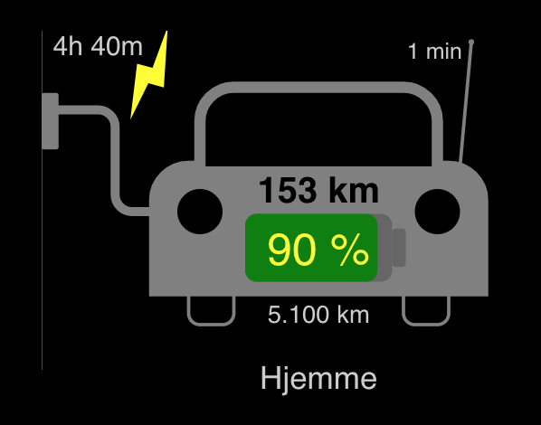
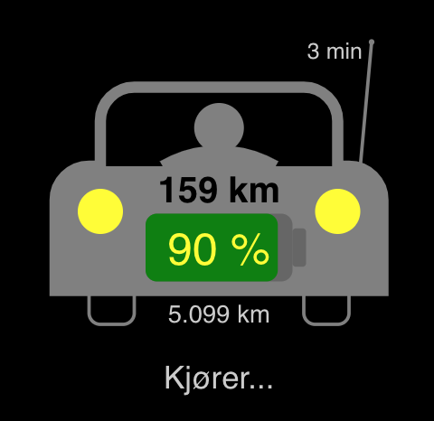

# MMM-WeConnect

MagicMirror module for Volkswagen cars via the **EU Data Act portal** — the only working data source for VW Group vehicles after the old WeConnect portal was shut down.

> ⚠️ **The old VW WeConnect portal (`portal.volkswagen-we.com`) has been shut down.** This module has been rewritten from scratch to use the EU Data Act portal (`eu-data-act.drivesomethinggreater.com`).

## Screenshots

Car connected and charging:



Car driving:



## What is displayed

| Information | Available |
|-------------|-----------|
| Battery level (%) | ✅ (depends on car model) |
| Estimated range | ✅ (depends on car model) |
| Charging status (charging / not charging) | ✅ |
| Remaining charging time | ✅ |
| Plug connected / disconnected | ✅ |
| Odometer | ✅ |
| Lock status (green = locked, red = unlocked) | ✅ |
| Outside temperature | ✅ |
| Time since last data from portal | ✅ |
| GPS position | ❌ (not available via EU Data Act) |

Data is updated by the portal approximately every 15 minutes **when the car is active** (driving, charging, or when you trigger a sync from the VW app). The module polls the portal automatically right after new data is expected.

## One-time portal setup (required)

Before the module works, you must activate continuous data delivery once in a browser:

1. Open **[https://eu-data-act.drivesomethinggreater.com/](https://eu-data-act.drivesomethinggreater.com/)**
2. Log in with your **VW account** (same email/password as the VW app)
3. Go to **Data clusters → Vehicle overview**
4. Click **Connect your car** if your car is not already listed
5. Click **Get customised data** → select *All data*, frequency *15 minutes*

The portal will then start generating datasets every ~15 minutes when the car is active.

## Installation

```bash
cd MagicMirror/modules
git clone https://github.com/ottopaulsen/MMM-WeConnect
cd MMM-WeConnect
npm install
```

## Configuration

Add this to your `MagicMirror/config/config.js`:

```javascript
{
    module: 'MMM-WeConnect',
    position: 'bottom_left',
    config: {
        email: 'your-vw-account@email.com',
        password: 'your-vw-password',
        vin: 'WVWZZZ1JZ3W000000',  // optional – auto-discovered if omitted
        size: 300,
        showDistance: true,
        showBatteryPercent: true,
        showRange: true,
        showConnectionStatus: true,
        showDriving: true,
        showBattery: true,
        logging: false,
        colors: {
            car: "gray",
            text: "#ccc",
            rangeText: "black",
            chargingSign: "yellow",
            lightsOn: "yellow",
            lightsOff: "#222",
            wheels: "#222"
        },
        batteryColors: [
            { upTo: 20, background: "pink", forground: "red", text: "yellow" },
            { upTo: 50, background: "pink", forground: "orange", text: "yellow" },
            { upTo: 75, background: "#666", forground: "blue", text: "yellow" },
            { upTo: 100, background: "#666", forground: "green", text: "yellow" }
        ],
        positions: [
            { name: "Home", lat: 63.430484, lon: 10.394966, marginMeters: 50 }
        ],
        homePosition: "Home"
    }
}
```

### Configuration parameters

| Parameter | Default | Description |
|-----------|---------|-------------|
| `email` | — | Your VW account email address |
| `password` | — | Your VW account password |
| `vin` | *(auto)* | Vehicle VIN number. Auto-discovered if omitted |
| `size` | `300` | Size of the SVG drawing in pixels |
| `showDistance` | `true` | Show total odometer reading |
| `showBatteryPercent` | `true` | Show battery percentage |
| `showRange` | `true` | Show estimated range |
| `showBattery` | `true` | Show battery indicator bar |
| `showConnectionStatus` | `true` | Show time since last data update |
| `showDriving` | `true` | Show driving status (lights/driver figure) |
| `showPosition` | `true` | Show position name (GPS-based — not currently available) |
| `logging` | `false` | Write detailed data to the console |
| `positions` | `[]` | List of known positions (name, coordinates, margin in metres) |
| `homePosition` | `""` | Name of the home position (used for distance display) |

## Security

**Keep your VW password secret!** It is stored in plain text in `config.js` — do not share this file with others.

## Dependencies

The module has only one external dependency:

- [`svg.js`](https://svgjs.dev/) — for the SVG car drawing

All HTTP calls, cookie handling and network checks use built-in Node.js modules (`fetch`, `dns`, `zlib`).

## Troubleshooting

Set `logging: true` in the configuration to see detailed data in the console, including all field values from the portal.

If the module displays *"Setup required – see log"*, it means you have not completed the one-time setup in the portal (see above).

## Contributing

Pull requests are welcome. Consider opening an issue first to discuss the changes you have in mind.

Here are my other [MagicMirror modules](https://github.com/ottopaulsen/magic).

